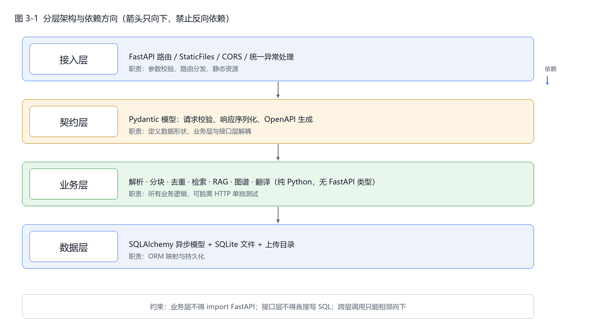
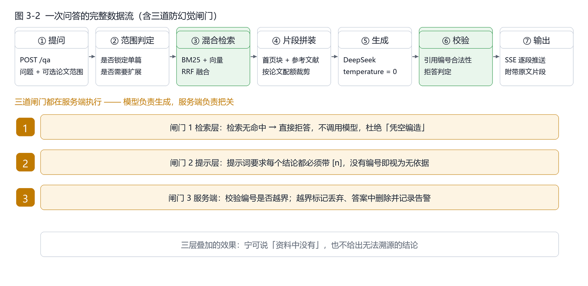
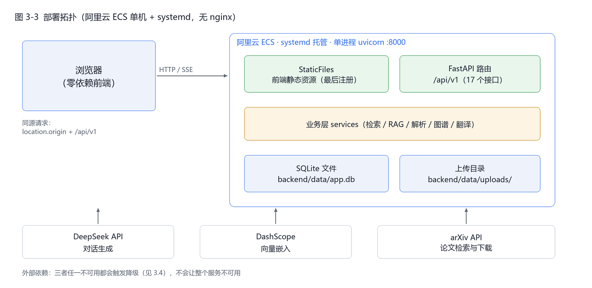

# 第 3 章 系统架构设计

## 3.1 分层架构



四层结构，**依赖只允许相邻向下**。这条约束不是形式主义，它直接换来三件实际好处：

| 分层 | 职责 | 违反时的后果 |
|---|---|---|
| 接入层 `api/` | 路由、参数绑定、状态码、静态资源 | 把业务逻辑写在路由里，接口无法脱离 HTTP 测试 |
| 契约层 `schemas/` | Pydantic 模型：校验、序列化、自动生成 OpenAPI | 前后端靠口头约定字段名，改一个字段就崩 |
| 业务层 `services/` | 解析、分块、去重、检索、RAG、图谱、翻译 | **业务层 import FastAPI 会导致逻辑无法复用与单测** |
| 数据层 `models/` + `db/` | ORM 映射、会话管理、持久化 | 在路由里直接写 SQL，事务边界失控 |

**实测收益**：业务层的 160 个后端测试**全部不需要启动 HTTP 服务**，直接构造数据库会话调用函数即可（见 7.1）。这是分层最直接的证据——如果业务层依赖了 FastAPI 的 `Request`，这个测试结构就写不出来。

## 3.2 一次问答的数据流



关键步骤的实现要点：

| 步骤 | 做什么 | 为什么这样做 |
|---|---|---|
| ② 范围判定 | 若请求指定了论文 ID，就在该范围内检索；否则全库检索 | 指定范围后再按标题"扩展"会把范围收窄到错误的一篇（实测踩过，见附录 B） |
| ③ 混合检索 | BM25 与向量各取候选，用 RRF（`1/(60+rank)`）融合 | 两路分数量纲不同，加权需要调参且不稳定；RRF 只用排名，免调参 |
| ④ 片段拼装 | 加入论文首页块、按需加入参考文献块、按论文配额裁剪 | 语义检索不保证把"作者名单""机构"这类元信息排进前列，而它们只出现在首页 |
| ⑤ 生成 | DeepSeek `deepseek-chat`，`temperature = 0` | 问答要的是可复现，不是文采；温度 0 让同一问题同一次检索给出同一答案 |
| ⑥ 校验 | 解析 `[n]` → 校验是否越界 → 构造引用 → 判定是否拒答 | 模型会编造不存在的编号（实测出现过引用 `[13]` 而上下文只有 12 条） |

**性能实测**（20 篇论文 / 4784 个分块）：检索约 0.2~0.4 秒，首字延迟 0.68~0.87 秒，完整回答 3~6 秒。

## 3.3 四个关键设计决策

架构文档最容易写成"我们用了什么"，但评委更关心"为什么不用别的"。以下是四处刻意选择：

**① 为什么用 SQLite 而不是向量数据库**
库规模是"个人级"——20 篇论文、4784 个分块，向量全部常驻内存也只有约 29 MB（4784 × 1536 × 4 字节）。引入 Milvus/Qdrant 需要额外部署与运维，而召回质量在万级规模下并无差别。**真正决定召回质量的是分块策略与融合方式，不是数据库品牌。** 代价是单机写并发弱，这在单用户场景下不构成问题；突破 10 万分块时应换成专用向量库。

**② 为什么前端零依赖（不用 React/Vue）**
整个前端是一个 `index.html` 加 18 个脚本文件，无构建步骤、无 node_modules。好处是：部署时不需要 `npm build`，评审拉下代码直接能跑；调试时改一行刷新即可。代价是缺少组件化与类型检查，用 79 个冒烟用例弥补（7.2）。

**③ 为什么前端由后端直接托管（不装 nginx）**
`StaticFiles` 挂载在根路径、**且最后注册**（否则会吞掉 `/api` 路由）。这样前后端同源：前端 API 基址取 `location.origin + /api/v1`，彻底消除 CORS 与跨域配置。演示环境是单机，nginx 的反向代理与静态加速收益抵不过多一层配置的风险。

**④ 为什么单进程 uvicorn 而不是多 worker**
检索索引（BM25 倒排 + 向量矩阵）在进程内构建并缓存，多 worker 会让每个进程各建一份、内存翻倍且彼此不同步。单进程配合异步 IO 足以支撑演示规模；真要多 worker，索引就必须外置到共享存储。

## 3.4 部署拓扑与降级矩阵



服务器为阿里云 ECS 单机，`systemd` 托管，端口 8000，数据在 `backend/data/`。**没有 nginx**，静态资源与 API 由同一个 uvicorn 进程提供。

外部依赖有三个，任一失效都必须降级而不是整体崩溃：

| 依赖 | 不可用时的表现 | 降级策略 | 实测验证方式 |
|---|---|---|---|
| DeepSeek（对话） | 无法生成答案 | 返回"大模型暂不可用"并**附上检索到的原文片段**，用户仍可阅读 | 单元测试注入异常 |
| DashScope（向量） | 只能关键词检索 | 回退 BM25，并在响应的 `degraded_reason` 中说明"置信度较低" | 线上真实发生（额度耗尽），验证通过 |
| arXiv（检索下载） | 发现页无法搜索 | 接口返回明确错误，界面提示"线上下载不可用" | 验证脚本第 12 节 |

**这里踩过一个真问题**：向量不可用时的降级路径曾被另一处"信息量过滤器"堵死——关键词结果被判定为高频词而跳过，导致两条路同时为空，问答直接拒答。修复后规则是：**过滤器只在"另有可用结果"时才允许丢弃**（详见附录 B）。

## 3.5 代码结构

```
backend/app/
├── main.py              # 应用装配：中间件、路由、静态资源、启动钩子
├── core/                # 配置、日志、异常、LLM 与嵌入客户端
├── api/v1/              # 17 个路由：papers / search / qa / graph / discover / health
├── schemas/             # Pydantic 契约
├── services/            # 业务层：parse / chunk / dedupe / retrieval / rag / graph / translate
├── models/              # SQLAlchemy 模型
└── db/                  # 会话与初始化
frontend/
├── index.html           # 单页应用入口（首屏前应用主题，避免闪烁）
├── scripts/core/        # 工具、状态管理、API 客户端、组件
├── scripts/views/       # 8 个视图
└── styles/              # 主题与视图样式
deploy/                  # 一键部署、线上验证脚本（43 项）
```

**规模**：后端约 5.5 千行 Python，前端约 6.7 千行 JavaScript（18 个文件），接口 17 个，数据库表 4 张（papers / chunks / citations / chunk_translations）。
