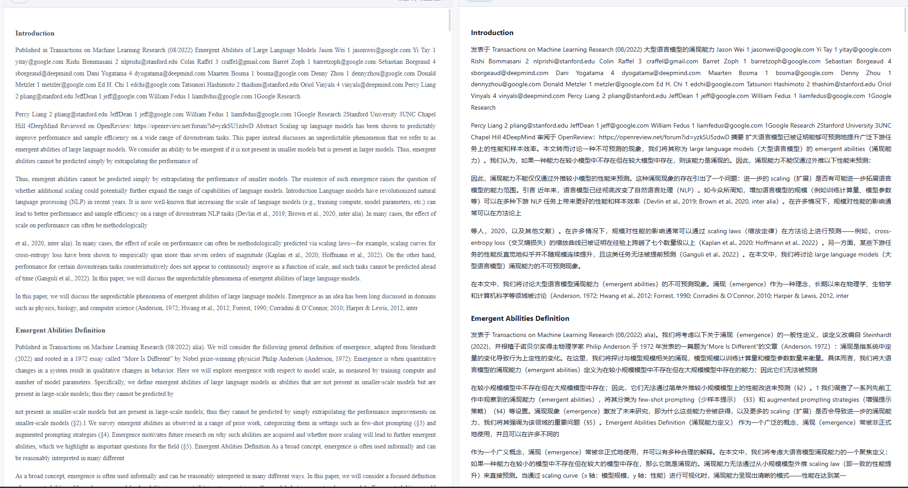
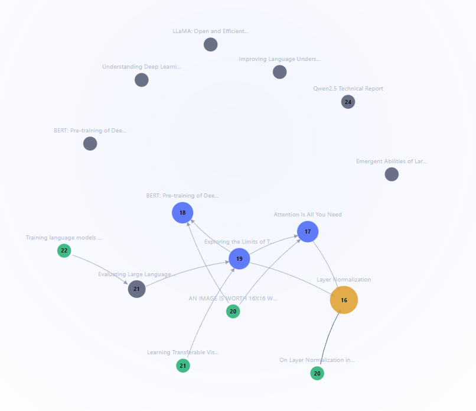

# 第 5 章 核心功能实现

## 5.1 PDF 解析流水线

解析分四步，每步都可能"看起来成功但结果是错的"，因此都留了质量信号：

| 步骤 | 做法 | 失败时如何暴露 |
|---|---|---|
| 抽取 | PyMuPDF 按块取文本，保留字号、坐标、页号 | 文本层为空 → 判定为扫描件 |
| 结构识别 | 字号聚类出标题层级，配合编号正则（`3.2.2`、`Appendix A`）推断父子关系 | 章节树为空 → 降级为单层目录 |
| 特殊区块 | 定位 References 段落并按 `[n]` 切分；识别表格区域与图注 | 参考文献数异常少 → 记录告警 |
| 质量评分 | 字符数/页数比、标题命中率、乱码比例加权 | 低于阈值标「需校对」，不标「已完成」 |

**质量分是刻意设计的**：541 页的《Understanding Deep Learning》得 1.00，BERT 的 arXiv PDF 只得 0.56（双栏 + 侧边行号导致文本流交错）。界面据此显示「需校对」徽章，而不是假装解析成功——**用户点进去看一眼就知道该不该信任它**。

## 5.2 内容去重：四级判定

需求要求识别「文件不同但内容相同」，并比较 v1 与 v7。四级判定按**强度从高到低**执行，命中即返回：

| 级别 | 判据 | 结论 |
|---|---|---|
| 1 | 文件 SHA-1 相同 | `identical`（重复上传） |
| 2 | 文件名含扫描件特征且归一化后同名 | `likely_duplicate`（扫描件与文本版） |
| 3 | arXiv 编号相同，比较版本号 | `newer_version` / `older_version` |
| 4 | 文件名归一化后相同（去前缀、去版本号、小写） | `likely_duplicate` |

**第 2 级必须排在第 3 级之前**：库中已有 `1706.03762v1.pdf`，用户再传 `1706.03762v1_img.pdf`（扫描件）。若先比版本号，会得到"版本号无法区分"，丢掉"这是扫描件"这条关键信息。

判定结果驱动弹窗：给出**稍后处理 / 两份都保留 / 保留文库版本 / 用新文件覆盖**四个选项，并按版本号自动把推荐项标在主按钮上（文库更新则推荐保留文库，反之推荐覆盖）。

## 5.3 分块与索引

分块用**句子级贪心装箱**：目标 700 字符、重叠 120 字符，每块前缀记录所属章节标题（参数定标见 4.1）。三个细节值得说明：按字符切会切断公式与引用编号，所以切成句子；标题必须随块携带，否则片段脱离上下文后无法判断归属；BM25 用中文 2-gram + 英文词形归一，避免依赖分词词典。

**索引常驻内存**：BM25 倒排表与向量矩阵在进程启动后构建一次并缓存。这是"单进程 uvicorn"的前提（见 3.3 ④），换多 worker 就必须外置索引。

## 5.4 混合检索与融合

```
用户问题
  ├─ BM25：取候选 → 按论文配额裁剪 → IDF 信息量校验
  └─ 向量：嵌入 → 余弦 Top-K → 按论文配额裁剪
        ↓
     RRF 融合：score = Σ 1/(60 + rank_i)
        ↓
   Top-16 片段（附带两路原始排名，便于排查）
```

**为什么用 RRF 而不是加权求和**：两路分数量纲完全不同（BM25 是几十，余弦是 0~1），加权需要针对语料调参且换库即失效；RRF 只用排名，**免调参**，代价是丢失分数间距信息（第 1 名与第 2 名的差距被抹平）。

**IDF 信息量校验**：若 BM25 前 5 条命中的最强词 IDF 相对区分度 < 0.5，说明搜到的全是"the / of / 模型"这类高频词，其排名是噪声——**跳过该路**，否则会把向量检索的正确答案挤下去。但这条规则有个前提：**必须另有可用结果**（见 5.4.1）。

### 5.4.1 降级链（线上真实踩坑）

线上嵌入额度耗尽时，问答整体拒答。排查发现两条路同时为空：

1. 向量检索抛 `FreeTierOnly` 异常 → 该路无结果；
2. 同一查询的 BM25 结果被 IDF 过滤器判为"信息量不足"而跳过。

**两个各自合理的设计叠加，产生了"完全不可用"**。修复原则：把被过滤的关键词结果存为 `bm25_fallback`，在向量路无产出时回退使用，并在响应的 `degraded_reason` 中声明「已回退、置信度较低」。

**教训**：降级链必须真的能降下去。之后我们把"故意让某条路失效"写进了测试（monkeypatch 掉 `embedding.is_available`），而不是等线上出事才发现。

## 5.5 问答编排

编排层做四件事，都在调用模型之前完成：

| 步骤 | 实现 | 为什么必须在模型之前 |
|---|---|---|
| 范围判定 | 指定了 `paper_ids` 就只在该范围检索 | 范围错则答案必错，事后无法纠正 |
| 首页块注入 | 按命中的论文取首页块并入上下文 | 作者、机构、单位只出现在首页，语义检索不保证召回 |
| 参考文献块注入 | 问题涉及"引用/参考文献/References"时补入 | 这类问题需要完整文献表，而非相似段落 |
| 片段数裁剪 | 已锁定范围时按 `max(2, ⌈top_k/篇数⌉)` 分配 | 多篇对比时保证每篇都有位置，避免一篇垄断 |

**流式输出**：`/qa/stream` 以 SSE 逐事件推送 `citations → token → done`。首字延迟 0.68~0.87 秒（含检索），比"等完整答案"体感快一个量级。

**引用校验**：模型输出后由服务端解析 `[n]`，只保留 `1 ≤ n ≤ 片段数` 的编号，其余丢弃并告警。实测出现过引用 `[13]` 而上下文只有 12 条片段的情况。


## 5.6 阅读与翻译

| 能力 | 实现要点 |
|---|---|
| 章节树导航 | 解析阶段生成三级目录；点击滚动到对应块并高亮当前节 |
| 整篇翻译 | 按块调用模型，结果写入 `chunk_translations` 表缓存；重复打开不再调用 |
| 代码/公式跳过 | 按块类型判定，代码块与公式块不入翻译队列（实测 57/57 块无代码被译） |
| 中英对照 | 左右双栏按块 ID 对齐，滚动互锁；一侧滚动时按块索引驱动另一侧 |
| 输出形态 | 网页重排 Markdown，而非原位 PDF 排版（取舍理由见 2.3） |

**为什么用块级缓存而不是整篇缓存**：整篇重译一次要 57 次调用；块级缓存让"改了某一段再读全文"只重译改动部分，也让失败重试按块粒度进行。



## 5.7 引用图谱

```
参考文献条目 → 抽取目标（arXiv 编号 / 标题 / 作者+年份）
        → 与库内论文匹配（多键，按可靠性排序）
        → 建图 → 入度 / PageRank / 连通分量
```

| 环节 | 实现要点 |
|---|---|
| 目标抽取 | 优先取 arXiv 编号（唯一且可读）；无编号则用标题归一化匹配；再退到"首作者+年份" |
| 匹配 | 多键匹配并按可靠性排序，命中即记录 `match_method`（便于排查误匹配） |
| PageRank | **自实现幂迭代**（α=0.85，最大 200 轮，收敛阈 1e-10），不引入 scipy——依赖已够多，且算法只有十几行 |
| 基石识别 | 入度为主、PageRank 为辅；实测库内 20 篇、632 节点 / 656 条边，识别出 Layer Normalization、T5、Attention、BERT |
| 边缘论文 | 低入度且与基石节点距离 ≥ 2 |



**踩过的坑**：最初对**全图**（含库外节点）计算 PageRank，结果库内论文的分数被大量库外节点稀释，排名几乎一样（都在 0.00625 附近）。改为在**库内诱导子图**上计算后才有区分度——**指标要在与问题匹配的图上算**。

## 5.8 论文发现（arXiv）

四个实现要点：**查询构造**——多词自动加引号按短语匹配（`all:"layer normalization"`）；**限速**——官方要求 ≥ 3 秒/次，代码内建延时，零结果重试前也须等满间隔；**下载校验**——校验 `%PDF` 文件头，因为 arXiv 限流时返回 HTML 错误页，不校验会把 HTML 当 PDF 入库；**入库复用**——直接复用 `paper_service` 的去重与落盘，不另写一套（避免"上传能去重、入库去不了重"），并在检索结果中标出哪些编号已在库。

**加引号的效果**：`all:layer normalization` 会混入大量物理论文；`all:"layer normalization"` 第一条就是《Layer Normalization》。这是**零成本的精度提升**，代价是召回略降（零结果时再等 3 秒用宽松查询重试一次）。
